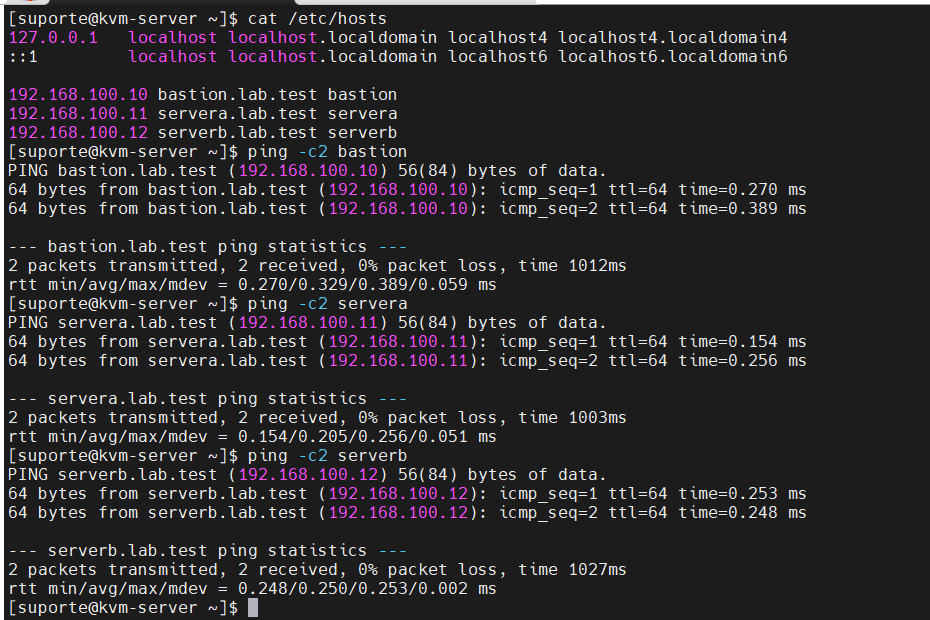
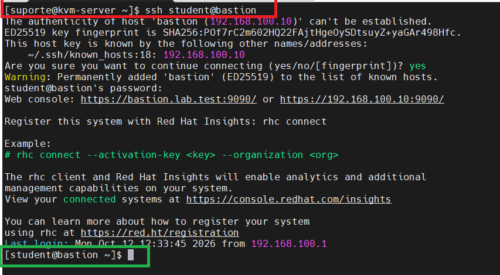
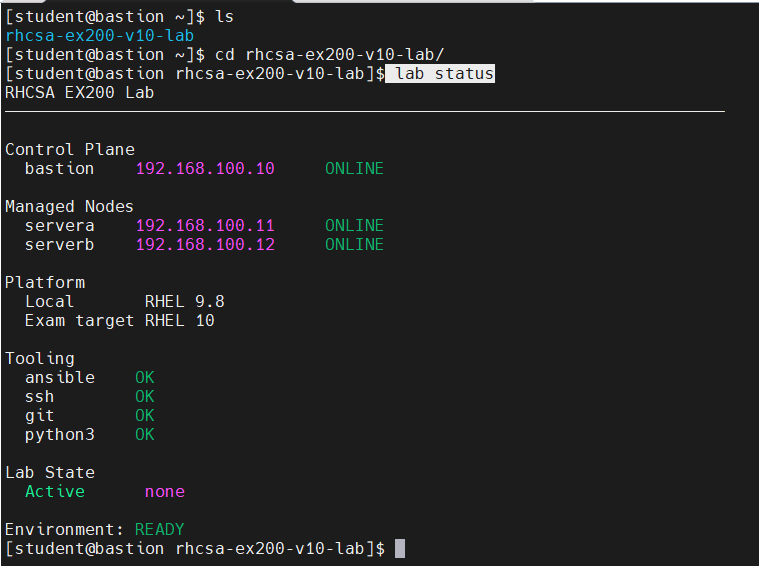
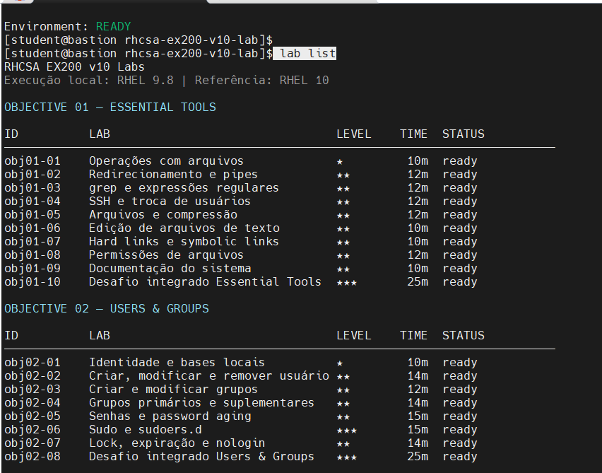
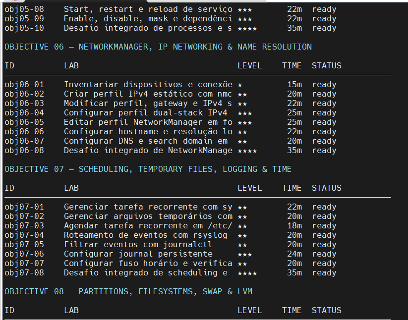

# RHCSA EX200 v10 Lab

## Manual operacional de execução dos laboratórios

**Guia do aluno — do primeiro acesso ao encerramento de cada prática**  
**Edição 1.0 · 12 de outubro de 2026**  
**Execução local:** RHEL 9.8 · **Referência de estudo:** RHEL 10 / EX200  
**Projeto independente · Sem gabaritos ou soluções dos exercícios**

> **Objetivo deste manual.** Ensinar a utilizar a infraestrutura e o comando `lab` com segurança e autonomia, a partir das capturas de tela, das saídas reais do terminal e da documentação do projeto. Este documento **não revela respostas**, não executa os desafios pelo estudante e não substitui o enunciado exibido pelo CLI. Não é um manual de instalação do ambiente.

**Repositório:** <https://github.com/eduardoandradej/rhcsa-ex200-v10-lab>  
**Procedimento de referência:** <https://github.com/eduardoandradej/rhcsa-ex200-v10-lab/blob/main/docs/setup/08-primeiro-lab.md>

---

## Índice de navegação

| Seção | O que você aprenderá |
|---|---|
| 1 | Identificar KVM, bastion e nós de prática |
| 2 | Testar conectividade e realizar o primeiro SSH |
| 3 | Confirmar `Environment: READY` |
| 4 | Navegar pelo catálogo de 100 laboratórios |
| 5 | Ler enunciados em português e inglês |
| 6 | Preparar o cenário e entrar na VM correta |
| 7 | Utilizar o grader sem consultar soluções |
| 8 | Encerrar e validar a limpeza |
| 9 | Repetir o fluxo de forma independente |
| 10 | Diagnosticar falhas operacionais comuns |
| 11 | Registrar progresso e revisar conteúdos |
| 12 | Conferir as fontes e limitações do guia |

**Como utilizar:** siga as seções 1–9 na primeira prática; nas sessões seguintes, use a tabela operacional da seção 9 e o checklist da seção 11. O capítulo 10 funciona como guia rápido de diagnóstico.

---

## 1. Entenda o ambiente antes de executar comandos

A infraestrutura é composta pelo **host KVM** e por três VMs. Há uma distinção essencial: a estação `kvm-server` hospeda a virtualização; `bastion` é o ponto de entrada para os comandos `lab`; `servera` e `serverb` são máquinas em que os exercícios são realizados.

| Equipamento | Endereço do laboratório | Função | O que executar |
|---|---|---|---|
| `kvm-server` | Host de virtualização | Gerenciar a infraestrutura KVM/libvirt | Testes de rede, VM, console e recuperação, quando necessário |
| `bastion.lab.test` (`bastion`) | `192.168.100.10` | Plano de controle / estação do estudante | `lab status`, `lab list`, `lab show`, `lab start`, `lab grade`, `lab finish` |
| `servera.lab.test` (`servera`) | `192.168.100.11` | Nó gerenciado / alvo de prática | Resolução manual de tarefas designadas para `servera` |
| `serverb.lab.test` (`serverb`) | `192.168.100.12` | Nó gerenciado / alvo de prática | Resolução manual de tarefas designadas para `serverb` |

**Regra principal:** os comandos `lab` pertencem à sessão do usuário `student` no **bastion**. Só execute tarefas do exercício no **alvo indicado por `lab show`**. Não trate o host de virtualização como alvo dos desafios.

### 1.1. Identifique o terminal correto

Um prompt como `[suporte@kvm-server ~]$` indica que você está no host físico ou hospedeiro. Um prompt como `[student@bastion ~]$` ou `[student@bastion rhcsa-ex200-v10-lab]$` indica que você está no bastion. Ao entrar no nó de prática, o prompt deve passar a identificar `servera` ou `serverb`.

> **Atenção:** mudar de diretório (`cd`) não muda de máquina. A mudança de host ocorre por uma nova sessão, por exemplo com `ssh`.

---

## 2. Primeiro acesso — do KVM ao bastion

**Onde executar:** sessão no `kvm-server`.

### 2.1. Verifique nomes e conectividade

As capturas mostram as três entradas do arquivo `/etc/hosts` e a comunicação sem perda de pacotes entre o host KVM e as VMs. Para consultar o ambiente já implantado, execute:

```bash
cat /etc/hosts
ping -c 2 bastion
ping -c 2 servera
ping -c 2 serverb
```

**Critério de avanço:** os nomes devem resolver para os IPs indicados na tabela e os três alvos devem responder. Os resultados da imagem são evidência do ambiente registrado, não uma garantia de que ele permanecerá disponível sem novas verificações.

{width=15.5cm}

*Figura 1 — Resolução dos nomes e conectividade no terminal do `kvm-server` (captura fornecida, recortada para legibilidade).*

Se algum teste falhar, **não inicie ainda o laboratório**. Verifique primeiramente a resolução de nomes e a situação das VMs; no `kvm-server`, dois comandos de consulta são:

```bash
getent hosts bastion servera serverb
sudo virsh list --all
```

Não altere rede, firewall, DNS ou configuração do hypervisor apenas para mascarar uma falha de conectividade.

### 2.2. Acesse o bastion por SSH

**Onde executar:** `kvm-server`.

```bash
ssh student@bastion
```

Na primeira conexão, o cliente SSH pode pedir confirmação da chave pública do host. **Confirme a identidade e a fingerprint por um canal confiável antes de aceitar a chave.** Em seguida, autentique-se pelo método configurado no seu ambiente. Não registre senhas no manual ou nos arquivos do projeto.

{width=15.5cm}

*Figura 2 — Sessão SSH estabelecida no bastion. Observe a mudança do prompt para `student@bastion`.*

**Critério de avanço:** visualizar o prompt do bastion. Daqui em diante, salvo indicação explícita, todos os comandos `lab` deste guia devem ser executados **nessa sessão**.

---

## 3. Preparação da sessão de estudo

**Onde executar:** `bastion`, como `student`.

Entre no diretório do projeto:

```bash
cd ~/rhcsa-ex200-v10-lab
pwd
```

Na instalação documentada, o diretório de trabalho esperado é `/home/student/rhcsa-ex200-v10-lab`.

Execute a verificação de saúde:

```bash
lab status
```

A captura e o arquivo de saída fornecidos mostram a seguinte condição:

```text
Control Plane
  bastion   192.168.100.10  ONLINE
Managed Nodes
  servera   192.168.100.11  ONLINE
  serverb   192.168.100.12  ONLINE
Tooling
  ansible   OK
  ssh       OK
  git       OK
  python3   OK
Lab State
  Active    none
Environment: READY
```

{width=15.5cm}

*Figura 3 — `lab status`: todos os nós on-line, ferramentas disponíveis, nenhum exercício ativo e ambiente pronto.*

### 3.1. Como interpretar a saída

| Indicador | Significado prático | Ação |
|---|---|---|
| `ONLINE` | O nó foi encontrado pela verificação do CLI | Avance, se os demais itens também estiverem corretos |
| `OK` nas ferramentas | Dependência consultada pelo CLI disponível | Avance |
| `Active none` | Não existe exercício ativo registrado | Um novo cenário pode ser iniciado |
| `Active objXX-YY` | Há um exercício em andamento | Continue esse exercício; não inicie outro |
| `Environment: READY` | Ambiente validado como pronto pelo CLI | É o estado desejado para começar |
| `Environment: DEGRADED` | A checagem detectou problema | Investigue e corrija antes de executar um novo cenário |

**Importante:** `RHEL 9.8` é a plataforma local demonstrada; `RHEL 10` é a referência de estudo indicada pelo projeto. Não confunda essa compatibilidade didática com uma afirmação de que você está operando RHEL 10.

---

## 4. Escolha o laboratório no catálogo

**Onde executar:** `bastion`.

```bash
lab list
```

O CLI apresenta as colunas `ID`, `LAB`, `LEVEL`, `TIME` e `STATUS`, agrupadas por objetivo. O arquivo de terminal fornecido lista **100 laboratórios**. Os nomes extensos podem aparecer truncados no formato de tabela, portanto use `lab show ID` para consultar os detalhes de um exercício.

{width=15.5cm}

*Figura 4 — Início de `lab list`, com os objetivos Essential Tools e Users & Groups.*

{width=15.5cm}

*Figura 5 — Trecho do catálogo com NetworkManager, Scheduling/Logging e Storage/LVM.*

Para reduzir a saída e estudar por domínio:

```bash
lab list --objective obj01
```

Também está documentado o filtro textual:

```bash
lab list --objective essential
```

**Leitura das colunas:** `ID` é o identificador usado nos comandos; `LEVEL` indica a dificuldade por estrelas; `TIME` é a estimativa de duração; `STATUS` informa a condição atual da prática. Antes de dar `start`, confira sempre se o exercício desejado consta como `ready`.

### 4.1. Visão geral dos 12 objetivos

| Objetivo | Conteúdo | Qtde. |
|---|---|---:|
| 01 | Essential Tools | 10 |
| 02 | Users & Groups | 8 |
| 03 | RPM, DNF & Repositories | 8 |
| 04 | Simple Shell Scripts | 8 |
| 05 | Processes, Scheduling, Tuning & systemd | 10 |
| 06 | NetworkManager, IP Networking & Name Resolution | 8 |
| 07 | Scheduling, Temporary Files, Logging & Time | 8 |
| 08 | Partitions, Filesystems, Swap & LVM | 12 |
| 09 | Boot, GRUB & Recovery | 7 |
| 10 | SELinux & firewalld | 9 |
| 11 | NFS & AutoFS | 6 |
| 12 | Comprehensive EX200 Challenges | 6 |
| **Total** | **Catálogo registrado** | **100** |

**Exceções identificadas na saída fornecida:** `obj09-04` (Rescue/emergency pelo console) e `obj09-06` (recuperação de acesso root pelo boot) aparecem como `manual-only`. Não tente executar `lab start` nesses itens como se fossem `ready`: eles exigem um procedimento manual próprio e acesso por console, conforme documentação aplicável. Para os demais itens, consulte o estado corrente exibido pelo CLI; a tabela de catálogo é um retrato do ambiente informado.

---

## 5. Leia o enunciado antes de iniciar

**Onde executar:** `bastion`.

Exemplo do primeiro item do catálogo:

```bash
lab show obj01-01
```

O arquivo de saída fornecido identifica os seguintes metadados, sem necessidade de revelar a resolução da tarefa:

| Campo | Valor exibido |
|---|---|
| `ID` | `obj01-01` |
| `Objective` | Objective 01 — Essential Tools |
| `Title` | Operações com arquivos |
| `Target` | `servera` |
| `Difficulty` | `★` |
| `Time` | `10 minutes` |
| `Compatibility` | Local: RHEL 9.8; Target: RHEL 10; Level: `exact` |
| `Reset policy` | `ansible` |
| `Status` | `ready` |

O texto completo da **Descrição** aparece no terminal quando você usa `lab show`; leia-o ali e identifique mentalmente os requisitos de estado final. Este guia **não transcreve as instruções da tarefa nem fornece uma sequência de comandos para cumpri-las**, preservando a tentativa autônoma.

### 5.1. Consultar o mesmo enunciado em inglês

```bash
lab show obj01-01 --lang en
```

O arquivo disponibilizado confirma as duas variantes: descrição padrão em português e opção `--lang en` em inglês. A troca de idioma altera a apresentação do enunciado, **não** o ambiente nem os critérios do grader.

### 5.2. Faça três verificações antes de começar

1. O `Status` é `ready`?
2. Qual é o `Target`: `servera`, `serverb` ou outro contexto descrito no enunciado?
3. Qual é o escopo solicitado e qual o tempo recomendado?

Somente após ler o texto integral e responder a essas perguntas, avance para `lab start`.

---

## 6. Inicie o cenário e faça a prática manual

### 6.1. Iniciar o exercício

**Onde executar:** `bastion`.

```bash
lab start obj01-01
```

Conforme o procedimento do repositório, esse comando prepara o ambiente por meio do `setup.yml`, informa `LAB READY` quando o preparo é bem-sucedido e registra o laboratório ativo. **Esse comando prepara o cenário; ele não responde ao exercício.**

Confira:

```bash
lab status
```

Para o exemplo em andamento, a seção `Lab State` deverá registrar `Active obj01-01`. Não inicie outro laboratório simultaneamente.

### 6.2. Entrar na VM definida pelo exercício

**Onde executar:** `bastion` → sessão remota no `servera`.

```bash
ssh servera
hostname -f
id -un
```

No primeiro exercício mostrado, o host esperado é `servera.lab.test` e o usuário esperado é `student`. Se o enunciado indicar outro alvo, **substitua `servera` pelo nome indicado**.

### 6.3. Inspecionar o ponto de partida, sem resolver a tarefa

**Onde executar:** `servera`, como `student`, **apenas para `obj01-01`**.

```bash
cd /home/student/rhcsa-lab/obj01-01
pwd
ls -la
ls -la input
```

Esses comandos permitem verificar o diretório e conhecer o material inicial. Eles **não são um gabarito**; os comandos necessários para atingir o estado final devem ser escolhidos e executados pelo estudante.

Antes de modificar qualquer recurso, confira o enunciado, identifique os elementos existentes e formule uma estratégia de validação própria. Em outro exercício, o caminho poderá ser diferente: use sempre o valor documentado para aquele ID.

### 6.4. Durante a tentativa

- Faça manualmente a tarefa no nó designado. Ansible é usado pelo projeto para preparar e restaurar cenários, não para responder em seu lugar.
- Não consulte `solution.md`, não rode playbooks de solução e não modifique `setup.yml`, `finish.yml` ou `grade.py` para obter pontuação.
- Consulte documentação local quando necessário, por exemplo `man`, `info`, `apropos` ou a opção `--help` dos comandos pertinentes, sem procurar o gabarito da tarefa.
- Confira por conta própria se o sistema ficou no estado descrito pelo enunciado **antes** de chamar o grader.

**Atenção a operações destrutivas:** em tarefas de disco, partição, swap e LVM, a documentação do projeto protege o disco do sistema (`/dev/vda`) e limita alterações destrutivas aos discos *scratch* autorizados. Identifique cuidadosamente cada dispositivo e respeite o enunciado. Não experimente em dispositivos não previstos.

---

## 7. Avalie o resultado sem receber a resposta pronta

Quando terminar sua tentativa, volte à sessão do bastion:

```bash
exit
```

**Onde executar:** `bastion`.

```bash
lab grade obj01-01
```

Enquanto esse laboratório estiver ativo, a forma reduzida documentada também funciona:

```bash
lab grade
```

O grader examina o **estado final observável** do sistema, e não a sequência de comandos digitados. Os critérios de avaliação podem aparecer com `[PASS]` ou `[FAIL]`; um exercício completo pode apresentar `Score: 100%` e `Resultado: PASS`. Pendências são identificadas como `Resultado: INCOMPLETE`.

### 7.1. Se houver falhas, pratique a correção autônoma

O caminho normal **não** é executar `lab start` outra vez. Mantenha o cenário ativo, retorne ao mesmo alvo e ajuste somente os requisitos que faltaram:

```bash
ssh servera
# Trabalhe manualmente no exercício ativo.
exit
lab grade obj01-01
```

**O comentário acima é uma instrução ao estudante, não um comando de resolução.** Repita o ciclo de inspeção → correção → avaliação enquanto for necessário. Anote quais conceitos você precisou rever e tente validar seu resultado antes de usar o grader novamente.

> **Para simular a pressão do EX200:** na primeira tentativa, use um tempo-limite e faça sua própria checagem de conformidade. O `lab grade` é recurso de aprendizagem do projeto, não deve ser confundido com um mecanismo disponível no exame oficial.

---

## 8. Encerre e confirme a limpeza do cenário

**Onde executar:** `bastion`.

Depois de concluir a prática e **somente quando não precisar mais preservar o cenário**:

```bash
lab finish obj01-01
```

Também existe a forma reduzida para o item ativo:

```bash
lab finish
```

O procedimento de referência informa que o CLI executa a limpeza (`finish.yml`), mostra `LAB FINISHED` em caso de sucesso e remove o registro de exercício ativo. No exemplo `obj01-01`, a limpeza elimina o diretório de prática daquele item em `servera`.

Confirme:

```bash
lab status
```

A conclusão bem-sucedida deve voltar a mostrar:

```text
Lab State
  Active      none
Environment: READY
```

**Não use `lab finish` enquanto ainda estiver diagnosticando uma tentativa.** Ele é a fase de encerramento/limpeza, não uma opção para corrigir erros de pontuação.

### 8.1. Se a limpeza falhar

Não apague manualmente `.state/active.json`, não force outro `lab start` e não restaure uma VM indiscriminadamente. Consulte a saída do erro e execute `lab status`. Se a recuperação exigir snapshot ou console, siga o procedimento de administração do host KVM e a documentação de baseline do projeto, preferencialmente com o ambiente parado e com o dispositivo correto confirmado.

---

## 9. Rotina repetível para os próximos exercícios

O ID `obj01-01` foi utilizado **somente como exemplo operacional**. Substitua por qualquer item exibido como `ready` em seu `lab list`, sempre respeitando `Target`, diretório e instruções de cada exercício.

| Etapa | Local | Ação | Ponto de controle |
|---|---|---|---|
| 1 | Bastion | `lab status` | `Environment: READY`; nenhum lab ativo |
| 2 | Bastion | `lab list --objective obj01` | Identificar item `ready` |
| 3 | Bastion | `lab show ID` | Ler enunciado completo e descobrir alvo |
| 4 | Bastion | `lab start ID` | `LAB READY`; item ativo |
| 5 | Alvo indicado | `ssh ALVO` e inspeção inicial | Host e usuário corretos |
| 6 | Alvo indicado | Resolver manualmente | Estado final conforme enunciado |
| 7 | Bastion | `lab grade ID` | Critérios e pontuação |
| 8 | Alvo / Bastion | Corrigir e repetir `lab grade ID`, se necessário | Sem gabarito |
| 9 | Bastion | `lab finish ID` | Limpeza concluída |
| 10 | Bastion | `lab status` | `Active none` e `READY` |

### 9.1. Exemplo compacto de uma sessão

Este bloco contém **somente comandos de navegação, operação e checagem**; nenhuma linha resolve o conteúdo do desafio.

```bash
# No bastion
cd ~/rhcsa-ex200-v10-lab
lab status
lab list --objective obj01
lab show obj01-01
lab start obj01-01
lab status

# Ainda no bastion: conectar ao alvo exibido
ssh servera
hostname -f
id -un
cd /home/student/rhcsa-lab/obj01-01
pwd
ls -la
# Daqui em diante, execute por conta própria a tarefa solicitada.
exit

# De volta ao bastion
lab grade obj01-01
# Se necessário, volte ao alvo, corrija e avalie novamente.
lab finish obj01-01
lab status
```

Não execute esse bloco inteiro de uma só vez: **pare depois da inspeção, resolva a tarefa e só então prossiga para `grade` e `finish`**.

---

## 10. Diagnóstico operacional rápido

| Situação observada | Primeiro passo seguro | O que evitar |
|---|---|---|
| `ssh student@bastion` não conecta | No KVM: `getent hosts bastion`, `ping -c 2 bastion` e consultar VMs | Alterar segurança SSH sem diagnóstico |
| `lab` não é encontrado | Confirmar que está em `student@bastion` e no ambiente configurado | Executar scripts desconhecidos como root |
| `Environment: DEGRADED` | Usar `lab status` para identificar nó/ferramenta afetados | Iniciar outro exercício |
| Um exercício está ativo | Continuar, avaliar ou finalizar o item mostrado | Abrir outro `lab start` |
| `lab grade` indica `[FAIL]` | Revisar o estado final no alvo e repetir o grader | Procurar `solution.md` como primeira resposta |
| `lab finish` falha | Preservar mensagem de erro e estado ativo; verificar conectividade e cleanup | Apagar estado do CLI manualmente |
| Item do catálogo é `manual-only` | Seguir procedimento próprio por console | Forçar a execução automatizada |
| Erro em armazenamento/boot | Interromper ação destrutiva; identificar host e disco corretos | Intervir em `/dev/vda` ou snapshot sem validação |

O projeto não deve ser atualizado de maneira improvisada durante um exercício ativo. Para inspeção do repositório local, `git status --short` e `git log -1 --oneline` são comandos de leitura úteis, mas não são etapas obrigatórias de cada prática. Uma atualização do Git deve seguir o procedimento de manutenção adotado para a versão instalada.

---

## 11. Registro de execução e método de estudo

Use um registro de estudo **sem anotar o gabarito**. Em cada tentativa, preencha:

| Campo | Preenchimento pelo aluno |
|---|---|
| Data e horário | __________________________________________ |
| ID e objetivo | __________________________________________ |
| Alvo / plataforma | __________________________________________ |
| Tempo estimado / tempo real | __________________________________________ |
| Pontuação obtida | __________________________________________ |
| Conceitos revisados | __________________________________________ |
| Erros encontrados (sem solução) | __________________________________________ |
| Validação manual realizada? | ☐ Sim ☐ Não |
| `lab finish` concluído? | ☐ Sim ☐ Não |
| `lab status` retornou `READY`? | ☐ Sim ☐ Não |

**Método sugerido:** primeiro faça uma tentativa sem consultar respostas; depois execute o grader e analise cada falha; finalmente, refaça o exercício em outro dia, sem reutilizar os comandos anteriores. Use a RHLS Premium para revisar os fundamentos que geraram dificuldades, usando o lab oficial, o Red Hat Bookshelf ou instrutores, mas preserve a resolução independente neste laboratório.

### 11.1. Checklist antes de avançar ao próximo ID

- [ ] Executei `lab status` e confirmei os nós e as ferramentas.
- [ ] Li o enunciado completo e confirmei o alvo do exercício.
- [ ] Fiz a tentativa manual, sem executar uma solução pronta.
- [ ] Conferi o resultado por conta própria antes do `grade`.
- [ ] Analisei os itens com `[FAIL]` e corrigi o necessário.
- [ ] Executei `lab finish` somente após encerrar a tentativa.
- [ ] Confirmei novamente `Active none` e `Environment: READY`.

---

## 12. Referências, limites e rastreabilidade

**Fontes usadas nesta edição:**

1. Capturas de tela disponibilizadas para este manual: `primeiro-acesso1.png` a `primeiro-acesso5.png`.
2. Saídas de terminal fornecidas: `Comando lab status.txt`, `Comando lab list.txt` e `Comando lab show PT-BR e EN.txt`.
3. Documentação do repositório: [08 — Primeiro exercício](https://github.com/eduardoandradej/rhcsa-ex200-v10-lab/blob/main/docs/setup/08-primeiro-lab.md).
4. Repositório do projeto: <https://github.com/eduardoandradej/rhcsa-ex200-v10-lab>.

**Critério editorial:** comandos de **operação do ambiente** são mostrados integralmente; comandos que solucionariam os enunciados dos laboratórios **não** são fornecidos. A existência do catálogo e a identificação dos hosts são verificadas a partir dos arquivos de saída e das capturas recebidas. Resultados futuros dependem do estado real das VMs e devem ser conferidos no terminal.

**Nota institucional:** projeto independente, sem vínculo de publicação, patrocínio ou certificação pela Red Hat; não reproduz questões reais do EX200 nem material proprietário da RHLS. O uso do termo RHEL 10 refere-se ao alvo de estudo apontado no projeto, não à versão local do sistema demonstrado.
